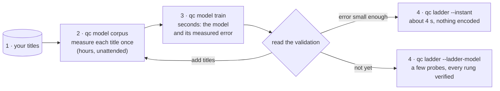

# Building a ladder model, step by step

A **ladder model** learns, from titles you measure once, how the encodes of
one encoder behave on your kind of content. `qc ladder` then needs far
fewer measurements for a new video, down to none: with `--instant` the
ladder is predicted from the analysis of the video in about 4 seconds.

This guide goes from a folder of videos to an instant ladder. How the model
works is in [ladder.md](ladder.md#probes-completed-by-a-model); what was
measured, in [validation.md](validation.md#probes-completed-by-a-model-qc-model).



What changes between a ladder without a model, with one, and instant is
**how much of the title's grid is measured**. A ladder is placed on the
rate-quality curves of the title, one per resolution; each point of a
curve is an encode at one CRF. Without a model, qc encodes and scores
enough of those points to draw the curves. With a model it encodes a few
(the **anchors**) and predicts the others; instant, it encodes none of
them, and reads instead two very fast encodes it scores during the
analysis (the **micro-anchor**).


## Before you start

- qc with ffmpeg and libvmaf working: `qc version --check`
  ([install](install.md)).
- **One model = one codec, one preset, one source resolution.** A model
  trained on 1080p sources encoded with x264 `fast` says nothing of 2160p
  sources, of AV1, or of x264 `slow`: `qc ladder` then falls back on its
  usual probes and says why. Decide these three first; the defaults are
  the ones `qc ladder` uses (x264 `fast`, SVT-AV1 preset 8, x265
  `veryfast`).
- Models cover **8-bit SDR** ladders. A 10-bit, HDR or film-grain ladder
  falls back on the usual probes.
- Disk: the excerpt of a title is cut as raw video in a temporary folder
  while it is measured, about 9 GB for two minutes of 1080p, removed
  afterwards.

## 1. Choose the titles

The model can only recognise kinds of content it has seen. What makes a
corpus good is **how different its titles are**, much more than how long
each one is:

- cover what you will ask ladders for: drama, animation, sport, news and
  studio shows, reality TV, documentaries, dark or grainy films, screen
  recordings…
- several titles of each kind rather than one long one;
- mezzanines or masters, not already-degraded encodes: a model learns
  what your sources look like;
- all at the **same resolution** (one corpus file per resolution).

How many? Three titles are enough to try the chain and too few to trust
an instant ladder (see [the validation](#read-the-validation)). Aim for
thirty to fifty to start, and let the validation tell you when to stop.

## 2. Measure the corpus

Put the videos in a folder (subfolders are read too) and run:

```sh
qc model corpus /path/to/titles/ --to corpus-1080p.jsonl
```

For each video, qc takes an excerpt (60 segments of 2 s spread evenly over
the title), encodes it at every resolution and at 11 CRFs (9 for AV1),
scores every frame with VMAF, and describes it (its analysis, and two very fast encodes
scored the same way). Everything is appended to `corpus-1080p.jsonl`.

What the file then holds, for a corpus of 30 titles: two surfaces over
the same grid, the VMAF and the bitrate of every resolution at every CRF.
A model learns the shape of these surfaces, and how a title's own
surfaces sit against them. The bars are the room titles take around the
mean: up to 27 VMAF points across the middle of the surface (1080p at CRF
48, 270p at CRF 13), and almost none at its two ends, where every title
is near VMAF 100 or near 0. That room is what a model has to place a new
title in.


**It is long, and it is meant to run unattended.** A title costs 55
encodes of its excerpt: around 40 minutes for two minutes of 1080p with
x264 on an Apple M2 Max.

- **Interrupt it whenever you want.** Run the same command again: what
  the file already holds is skipped.
- **A title that fails does not stop the others.** It is marked `failed`,
  the run goes on, and the errors are listed at the end (qc then exits
  with an error). Fix or remove the file and run the command again.
- **Add titles later** the same way: drop them in the folder, run the
  command again.
- **Make it cheaper** with fewer segments per title when you have many
  titles: `--segments 20` costs a third, and twenty more titles are worth
  more than forty more seconds of each.
- **Another codec** goes in the same file: `-c av1` adds its encodes, and
  the description of each title is reused. Each codec has its own grid:
  AV1 is measured at 9 CRFs, 16 to 58 every 6, then 63, the highest of
  SVT-AV1 (45 encodes a title). The low rungs of a title that compresses
  well are up there, at 1080p and CRF 60 to 62, and the last steps of that
  scale cannot be read from the points before them.

| Flag | Default | When to change it |
|---|---|---|
| `--to` | required | the corpus file; keep one per source resolution |
| `-c`, `--codec` | h264 | the codec you build ladders for |
| `--preset` | the ladder preset of the codec | only if your ladders use another `--preset` |
| `--segments` | 60 | fewer for a large corpus, to measure more titles in the same time |
| `--heights` | 2160…270 | only if your ladders use other `--heights`: a model covers exactly the resolutions it was trained on |
| `--crf-count` | 11 for H.264 (13 to 48, every 3.5), 9 for AV1 (16 to 63) | fewer to measure faster, more to read finer between them: see below |
| `--crfs` | the CRFs of `--crf-count`, listed | rarely |

**How many CRFs.** The cost of a title is its number of resolutions
times its number of CRFs: `--crf-count 6` halves it, `--crf-count 21`
doubles it. What it buys is how well a ladder reads *between* two CRFs of
the grid, nothing else: each point of the grid has its own model, so more
CRFs do not make the others more exact. On 30 titles, reading a point
from its neighbours:

| `--crf-count` | CRFs (H.264) | Encodes per title | Reading between two CRFs |
|---|---|---|---|
| 6 | 13, 20, 27, 34, 41, 48 | 30 | 0.7 VMAF and 1.2% of bitrate off (measured) |
| 11 (default) | every 3.5 | 55 | about 0.2 VMAF and 0.3% (a quarter: the error goes as the square of the step) |
| 21 | every 1.75 | 105 | about 0.05 VMAF and 0.1% |

The default is where that error stops mattering next to the model's own.
The same holds for AV1 and its CRFs every 6: on 17 titles, a point read
from neighbours 12 apart is 0.49 VMAF and 1.8% of bitrate off, so about
0.12 VMAF and 0.5% at the default step, against 1.2 VMAF and 8% for the
instant prediction itself. A finer grid lowers only the first of the
two; what lowers the second is more titles, and titles unlike those the
corpus has ([the report](#see-the-model-and-its-corpus) shows which).
**Keep one count for a whole corpus**: a model is trained on titles
measured at the same points, and `qc model train` leaves the others out.
The counts 6, 11 and 21 share their CRFs, so a corpus started with one
can be completed with a larger one by running the command again.

> The resolutions of the corpus must be those of your ladders. With the
> default `--heights` on both sides there is nothing to do.

## 3. Train the model

```sh
qc model train corpus-1080p.jsonl -c h264 --to h264-fast-1080p.json
```

It takes a few seconds, and prints what the model is worth:

```
h264 fast, 1080p sources: 3 titles, 180 segments, grid of 5 resolutions × 11 CRFs

anchors  resolution@CRF                              VMAF error (mean)  (worst)  bitrate error (mean)
10       1080p@23.5 1080p@41 720p@30.5 …              0.31               2.88     1.6%
7        1080p@23.5 720p@30.5 540p@23.5 …             0.41               3.10     1.7%
4        1080p@23.5 1080p@41 540p@30.5 270p@23.5      0.48               3.48     2.0%
…
1        1080p@23.5 + the analysis                    1.02               4.70     10.5%
0        the analysis alone (--instant)               1.16               6.13     7.7%

Errors on digests of titles left out of the training, over the qualities a ladder uses.
From the analysis alone, without any encode: VMAF within 1.2 on average of a title the model has not seen.
```

Each line is a way of using the model: with that many measured encodes
(**anchors**) per ladder. The last line, zero anchor, is the instant mode.

### Read the validation

These errors are **honest by construction**: each title of the corpus was
predicted by a model trained on all the *others*, so they are errors on
content the model had not seen. Read the last line:

| VMAF error of "the analysis alone" | What it means for `--instant` |
|---|---|
| under 0.5 | as good as a measured ladder: `qc ladder --ladder-model` now goes instant by itself |
| 0.5 to 1 | most rungs within one CRF step of where a verified ladder puts them |
| 1 to 2 | right on content close to the corpus, 2 to 3 VMAF off on content unlike it: fine to explore, verify before you publish |
| over 2, or the line is missing | add titles; meanwhile use the model with anchors ([step 4](#the-safer-modes)) |

The same numbers as a picture, on the three titles of the
[validation](validation.md#probes-completed-by-a-model-qc-model): each bar
is a way of using one model, from nothing measured to ten anchors. The
first bar is the analysis before qc scored its two fast encodes: that
micro-anchor is what makes an instant ladder possible at all.


Two more things to look at:

- the **bitrate error**: an instant ladder announces bitrates about that
  far from the real ones (8% in the example). Before you declare
  bitrates in a manifest, measure them (`--probing predicted`, below);
- the **worst** error: one bad point of the grid, usually a corner no
  rung uses. A worst error that is very large compared with the mean
  means one title of the corpus is unlike all the others: that kind of
  content needs companions.

The lines without anchor come in up to four: `the analysis alone
(--instant)`, `the frames alone (--instant --no-encode)`, and each again
with `source quantisers unknown`, for sources whose decoder does not tell
them (anything but 8-bit H.264). A build takes the one it can feed.

If the line `the analysis alone` is missing and the output says *No design
from the analysis alone*, or if every line without anchor says `source
quantisers unknown`, the corpus was described by an earlier version of
qc: run `qc model corpus` again on the same folder and file, it adds the
descriptions without redoing the encodes (the videos must still be
there).

### See the model and its corpus

```sh
qc model report corpus-1080p.jsonl --model h264-fast-1080p.json --to model.html
```

writes one HTML page, self-contained like the other reports of qc, that
answers before any ladder is built:

| Section | What it answers |
|---|---|
| Findings | does the model predict without a probe (`--instant`), without any encode (`--no-encode`), and how far from a measured ladder; is it older than its corpus; are titles unfinished; does the grid stop before the low rungs |
| Designs | the error of each design, as bars: the table of `qc model train` |
| Error across the grid | where the main designs are wrong: the error of each resolution and CRF, for the VMAF and for the bitrate |
| Error by title | which titles the model reads worst when it has not seen them: the kinds of content the corpus needs next |
| Surfaces | the VMAF and the bitrate of the corpus over the grid, in perspective: drag to turn them, point at a corner to read it, pick a title or play them all to see each against the mean |
| Rate–quality curves | the mean curve of each resolution, and where they cross |
| Coverage | one dot per title on each feature the model reads: a gap is a kind of title the corpus has none of |

Give the corpus alone (`qc model report corpus.jsonl -c av1 --to
corpus.html`) while it is being measured, or the model alone (`--model`)
when the corpus is elsewhere: each shows its part. The error by title is
kept in the model by `qc model train`; a model trained by an earlier
version is trained again to show it.

The page names the titles of the corpus by their file names: mind who
you send it to.

What adding titles does, measured on a corpus of 39 titles of 30 s:
predictions stop moving from one training to the next, about as one over
the number of titles, and the errors fall slowly (instant, from 5 to 34
titles: 9.0% to 6.8% of the bitrate, 1.4 to 1.1 VMAF). A corpus makes
instant ladders **steady**; it is the anchors that make bitrates
**exact**.


**How many titles for a ladder that no longer moves?** The change of a
predicted bitrate when one title joins the corpus is close to a constant
divided by the number of titles. On that corpus:

| A predicted bitrate changes by less than 1%… | Instant | 4 anchors |
|---|---|---|
| on average, over the rungs | 13 titles | 7 titles |
| for 95% of the rungs | 34 titles | 20 titles |
| on average, for the top rung | 31 titles | 12 titles |
| for the top rung of 95% of the videos | about 95 titles | about 45 titles |

Counts up to 34 titles were measured; the larger ones follow the same
law, drawn further (at 34 titles, instant: 1.0% for 95% of the rungs, 0.9%
on average and 3.0% for 95% of the videos for the top rung). The top rung
moves most because quality saturates there: a tenth of a VMAF point is
several percent of bitrate. These are counts of **titles that differ**:
thirty seconds of each are enough.

Steady is not exact: at 34 titles an instant ladder still announces
bitrates about 7% from the measured ones on that corpus, where four
anchors are within 2.3%.

**What the titles hold matters as much as their number.** A model
predicts well what looks like its corpus. Samples made of the most
complex scenes of each title (`qc sample --scenes top`, or the half of a
`mixed` sample) teach little of quiet content: against a corpus of 39
such samples, a two-person dialogue had more than half of its segments
under the 5th percentile of the corpus in temporal and in spatial
information, and its 1080p and 720p curves came out a point too low,
enough to send four rungs to 540p; the calmest of those samples was as
busy as a whole reality show. Give the corpus what your
catalogue holds, easy scenes included: `--scenes average`, or whole
excerpts taken evenly.

Training again after adding titles is the way to follow progress: the
error of that last line is the number to watch. It can be done **while
the corpus is being measured**: a title not finished yet is left out, and
named at the end of the output.

## 4. Build ladders with the model

### Instant

```sh
qc ladder video.mp4 --ladder-model h264-fast-1080p.json --instant
```

Nothing is encoded for the ladder: an evenly spread digest of the video is
cut, analysed, and the model predicts the curves the rungs are placed on.
About 4 s for a title of ten minutes or of an hour (1.6 s cutting the
digest, 2.4 s describing it). The digest of an instant ladder is 20 s
long, ten segments; `--digest-duration 40` reads twenty, in 7.5 s, for
about a tenth less error.

```
digest   20 segment(s), evenly spaced · 0:40.000 · 6.3% of the title · 0 probe encodes
         (55 predicted from the analysis of the digest by a model of 2 titles, nothing
         measured, within 1.2 VMAF on average on titles it had not seen)

Ladder
  #   resolution      bitrate    CRF     maxrate       VMAF
  1   1280×720      2.53 Mb/s   17.0   5.06 Mb/s       95.1
  2   1280×720      1.01 Mb/s   23.0   2.02 Mb/s       90.5
  …
```

What such a prediction looks like against the truth, on a cartoon the
model had never seen: the line is predicted from the analysis, the dots
are the encodes it did not make. The curves are right within about a VMAF
point at the qualities a ladder uses; the bitrates lean 10 to 20% low, and
the low end of the high resolutions, which no rung uses, is the furthest
off.


The `digest` line always says what the ladder rests on: how many probes
were encoded (none), and the error of the model on titles it had not
seen. Every VMAF and bitrate of an instant ladder is a **prediction**.
`-o ladder.json`, `--html`, `--commands` and the ladder flags (`--rungs`,
`--top-vmaf`, `--max-bitrate`…) work as usual.

### The safer modes

The same model serves three levels of caution. Pick by what the
validation told you:

| Command | What is measured | Time (1 h title) | Use it when |
|---|---|---|---|
| `qc ladder v.mp4 --ladder-model m.json --instant --no-encode` | nothing, and nothing encoded to describe the video either | ~2 s | sorting or pre-sizing a catalogue: about twice the error of the line below |
| `qc ladder v.mp4 --ladder-model m.json --instant` | nothing | ~4 s | the validation is good enough for what you do with the ladder |
| `qc ladder v.mp4 --ladder-model m.json --probing predicted --digest uniform` | every rung is encoded on the digest and corrected when it misses | 1–2 min | you want the speed of the prediction and measured rungs |
| `qc ladder v.mp4 --ladder-model m.json` | a few probes (4 to 10), then every rung verified | 3–4 min | the corpus is still small: within 0.5 VMAF on titles never seen with three titles |
| `qc ladder v.mp4` | 15 to 30 probes, every rung verified | 7 min | no model |


`--tolerance` (default 0.5 VMAF) is how much error you accept from the
model in the third mode: it measures the fewest anchors whose validated
error is within it, and none at all once the instant design is. Raising it
(`--tolerance 0.8`) trades accuracy for speed.

### When the model is not used

`qc ladder` never fails because of a model: when the model does not cover
the build, the usual probes run and the report says why, for instance:

```
ladder model not used: the model is for h264 fast on 1080p sources, not av1 8 on 1080p
```

The causes: another codec or `--preset`, a source of another resolution,
other `--heights`, 10-bit encodes, an HDR source, film grain synthesis.
With `--instant` the usual probes then run, still without verification:
a ladder that takes minutes where seconds were expected has that line in
its report. With `--no-encode` nothing runs: the build stops and says
why.

When the model is used, an instant ladder encodes nothing, whatever the
title. A rung that would need a CRF past the grid of the model is placed
on what the model knows, at a lower resolution: nothing is measured to
find out.
Several models can be given at once, one per codec
(`--ladder-model h264.json,av1.json -c h264,av1`): each ladder takes the
one that covers it.

## 5. Keep the model alive

- **Add titles** when a kind of content gives poor ladders, or simply as
  new programmes arrive: `qc model corpus` on the folder, then `qc model
  train`. Compare the error of the last line with the previous training,
  and look at the titles `qc model report` ranks first in its error by
  title: they tell what to add.
- **A new version of the encoder** (x264, SVT-AV1) or another preset
  changes what the model learnt: measure a corpus for it (another file,
  or the same with `--preset`), train again.
- **A corpus of AV1 measured before its grid reached CRF 63** stops at
  CRF 58: instant ladders then put the low rungs of titles that compress
  well at 540p and 360p where they belong at 1080p and 720p. Run `qc model
  corpus -c av1` again on the folder (it adds the five encodes at CRF 63
  of each title and keeps the others), then train again once every title
  has them: `qc model train` leaves out the titles not yet completed.
- **Check on real titles** now and then: run a title the model has not
  seen with `--probing predicted --digest uniform` and look at how many
  rungs the verification marked `calibrated`. None or one: the instant
  ladders of that kind of content can be trusted.
- **Keep the corpus file.** It is the expensive part; a model is retrained
  from it in seconds, and a future version of qc may learn more from the
  same measurements.

## Recap

```sh
# once, and each time titles are added (hours, resumable)
qc model corpus /path/to/titles/ --to corpus-1080p.jsonl

# seconds: prints the error of every mode on titles left out
qc model train corpus-1080p.jsonl --to h264-fast-1080p.json

# a page to read the model and its corpus on
qc model report corpus-1080p.jsonl --model h264-fast-1080p.json --to model.html

# about 4 s per video
qc ladder video.mp4 --ladder-model h264-fast-1080p.json --instant
```

## Questions

**My sources are 1080p and 2160p.** Two corpus files and two models, one
per resolution, each measured with the titles of that resolution. Give
both to `--ladder-model`: the one matching the source is used.

**Can I mix resolutions in one corpus file?** `qc model corpus` will
measure them, but `qc model train` refuses a corpus whose titles differ in
resolution and names the two files. Keep one file per resolution.

**Do segments of the same title count as many examples?** They make the
fit steadier, not the model wiser: sixty segments of one drama teach what
that drama is. Different titles are what lower the validation error.

**Why is the instant ladder not verified?** Verifying is encoding, which
is what `--instant` exists to avoid. `--probing predicted` is the instant
prediction with the verification kept.

**One of my videos has frames missing, or a frame rate slightly off.** It
is measured like the others: its excerpt is cut by counting frames at its
nominal rate, and gives one segment fewer than a steady title of that
length.

**What does a title of the corpus cost in disk?** The corpus file itself
is small (a few hundred kB per title). The 9 GB of the excerpt are
temporary.

**Can I see what the model reads of a video?** The corpus file holds it,
one line of kind `features` per title: spatial and temporal information,
luma, camera motion, what x264 at its fastest spends on the video at 360p
and the VMAF it reaches, what scaling to each resolution loses
([details](ladder.md#from-the-analysis-alone---instant)).

---

The charts of this page are drawn by
[`assets/model/charts.py`](assets/model/charts.py) from the measurements
of [validation.md](validation.md#probes-completed-by-a-model-qc-model),
where every number they show is also in a table.
